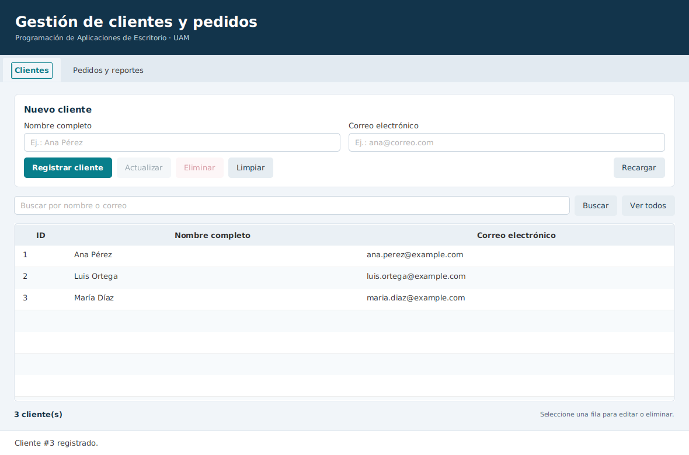
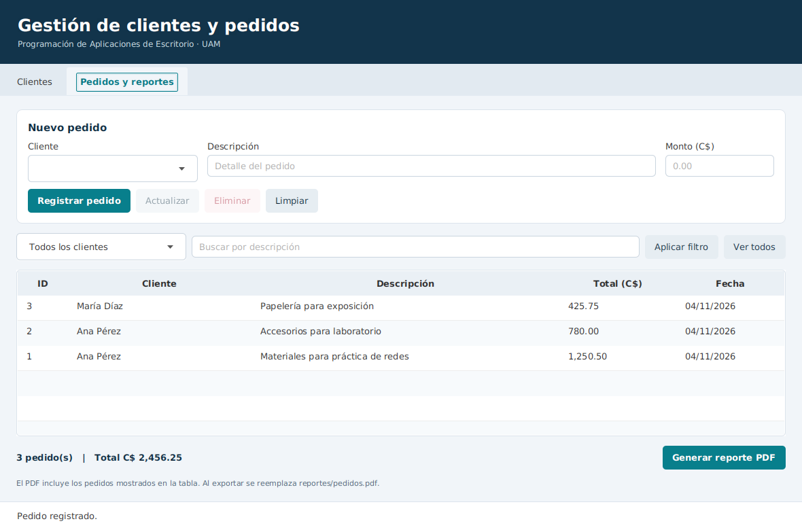

# Gestión de clientes y pedidos

Aplicación de escritorio para registrar clientes, administrar sus pedidos y generar reportes PDF. Desarrollada para la práctica de las sesiones 34, 35 y 36 de Programación de Aplicaciones de Escritorio, Universidad Americana.

**Estudiante:** Rolando Enrique Mayorga Mena

**Modalidad:** individual

**Docente:** MSc. José Alejandro Durán García

El proyecto parte del material proporcionado en clase y completa los botones Limpiar, las consultas por cliente, el filtro de pedidos y los entregables de la guía. Se conservan las entidades Cliente y Pedido. El caso de equipos mencionado en el plan semanal corresponde a otro planteamiento; esta entrega sigue la guía específica de clientes y pedidos y su ZIP.

## Funciones

- Registrar, consultar, actualizar y eliminar clientes y pedidos.
- Buscar clientes por nombre o correo, sin distinguir mayúsculas.
- Consultar pedidos de un cliente y combinar el filtro con una descripción parcial.
- Rechazar correos duplicados, campos vacíos y montos inválidos.
- Confirmar las eliminaciones. Al borrar un cliente también se borran sus pedidos.
- Generar `reportes/pedidos.pdf` con los datos que aparecen en la tabla, su filtro, cantidad de pedidos y total en córdobas.
- Ejecutar las operaciones de base de datos y la exportación sin bloquear la ventana.





## Requisitos

| Herramienta | Versión utilizada |
| --- | --- |
| Java JDK | 21 |
| Maven | 3.9.9, incluido mediante Maven Wrapper |
| JavaFX | 21.0.6 |
| Hibernate ORM | 6.6.59.Final |
| PostgreSQL | 16.6 para las pruebas; requiere PostgreSQL 15 o posterior |
| JasperReports | 6.21.3 |

Se necesita internet para descargar las dependencias la primera vez. Jaspersoft Studio compatible con JasperReports 6.x solo hace falta para editar visualmente el diseño JRXML.

## Preparar PostgreSQL

En pgAdmin, abrir Query Tool conectado a la base `postgres` y ejecutar:

```sql
CREATE DATABASE gestion_uam;
```

Después, abrir Query Tool **conectado a `gestion_uam`** y ejecutar, en este orden:

1. `sql/01_esquema.sql`
2. `sql/02_datos_ejemplo.sql`, si se desean cargar los tres clientes y tres pedidos de muestra.

`sql/00_crear_base.sql` contiene la misma instrucción de creación de base. No repetirla si la base ya existe. Los datos de ejemplo se pueden cargar más de una vez sin duplicar esas mismas filas.

El esquema incluye claves foráneas, restricciones e índice de correo normalizado. Conviene ejecutarlo antes de abrir la aplicación: `hbm2ddl.auto=update` facilita la práctica, pero no sustituye las restricciones adicionales del script.

## Configurar la conexión

Desde la raíz del proyecto, copiar el archivo de ejemplo:

```powershell
Copy-Item config/local.properties.example config/local.properties
```

En Linux o macOS:

```bash
cp config/local.properties.example config/local.properties
```

Editar **solo** `config/local.properties`:

```properties
db.url=jdbc:postgresql://localhost:5432/gestion_uam
db.user=postgres
db.password=CAMBIAR_AQUI
```

Sustituir el último valor por la contraseña local de PostgreSQL. Este archivo está excluido de Git. No escribir la contraseña en `hibernate.properties`, el README ni los comandos de un commit.

También se aceptan las variables `DB_URL`, `DB_USER` y `DB_PASSWORD`. Si están definidas tienen prioridad sobre el archivo local. El archivo `hibernate.properties` aporta los valores predeterminados y la configuración de Hibernate.

## Abrir y ejecutar

1. Abrir la carpeta que contiene `pom.xml` en IntelliJ IDEA.
2. Seleccionar JDK 21 como Project SDK y como JRE de Maven. Recargar el proyecto Maven.
3. Mantener PostgreSQL iniciado y la conexión configurada.
4. Ejecutar en la terminal de IntelliJ, desde la raíz:

```powershell
.\mvnw.cmd clean javafx:run
```

En Linux o macOS:

```bash
./mvnw clean javafx:run
```

Si Maven ya está instalado, también funciona `mvn clean javafx:run`. El Wrapper descarga Maven; no incluye ni instala Java o PostgreSQL.

## Uso del formulario

En **Clientes**, completar nombre y correo y pulsar **Registrar cliente**. Seleccionar una fila para cargarla, modificar los campos y pulsar **Actualizar**. **Limpiar** quita la selección y prepara un registro nuevo. La búsqueda revisa tanto el nombre como el correo.

En **Pedidos y reportes**, seleccionar un cliente, escribir la descripción y el monto; por ejemplo, `1250.50`. Los valores se expresan en córdobas y admiten hasta dos decimales con punto. Seleccionar un pedido permite actualizarlo, cambiar su cliente o eliminarlo. La fecha se asigna al registrarlo y se conserva al editar.

Para consultar por cliente, usar el segundo ComboBox y pulsar **Aplicar filtro**. También se puede escribir una descripción y combinar ambos criterios. **Ver todos** elimina los filtros. Si no hay coincidencias se muestra una tabla vacía y un mensaje.

**Generar reporte PDF** exporta el último listado consultado. Escribir un filtro sin aplicarlo no modifica el contenido ni el rótulo del reporte. Cada exportación reemplaza `reportes/pedidos.pdf`; si se desea conservar una versión, copiarla antes de volver a generar. Un listado vacío produce un PDF que informa que no hay pedidos.

Con la carga de ejemplo deben aparecer tres pedidos por **C$ 2,456.25**. El PDF incluido para consulta está en [docs/evidencias/pedidos_ejemplo.pdf](docs/evidencias/pedidos_ejemplo.pdf).

## Organización del código

| Carpeta | Responsabilidad |
| --- | --- |
| `model` | Entidades JPA y relación Cliente 1:N Pedido. |
| `repository` | Persistencia y consultas HQL parametrizadas. |
| `service` | Validaciones y operaciones completas de negocio. |
| `config` | Configuración, SessionFactory y commit/rollback. |
| `controller` | Eventos, selección de filas y tareas JavaFX. |
| `report` | DTO de salida y generación del PDF. |
| `src/main/resources/fxml` | Formulario principal. |
| `src/main/resources/reports` | Plantilla editable de JasperReports. |
| `sql` | Creación, carga inicial y consultas de comprobación. |
| `src/test/java` | Pruebas de validaciones, PDF, PostgreSQL e interfaz. |
| `docs` | Evidencias, verificación y reflexión sobre el diseño. |

El recorrido de una escritura es: botón, controlador, servicio, transacción, repositorio y PostgreSQL. El controlador no abre sesiones ni ejecuta consultas. Las actualizaciones modifican entidades administradas; Hibernate detecta los cambios al hacer `commit()`.

## Pruebas

Las pruebas de validaciones, configuración y reportes no necesitan PostgreSQL:

```powershell
.\mvnw.cmd test
```

Para las pruebas de persistencia, crear **una base separada** ejecutando `sql/04_crear_base_pruebas.sql` conectado a `postgres`. En una terminal PowerShell:

```powershell
$env:TEST_DB_URL = "jdbc:postgresql://localhost:5432/gestion_uam_test"
$env:TEST_DB_USER = "postgres"
$env:TEST_DB_PASSWORD = Read-Host "Contraseña local de PostgreSQL"
.\mvnw.cmd -Ppostgres clean verify
```

Las pruebas aceptan únicamente una URL cuya base sea `gestion_uam_test`. Borran y recrean sus tablas, así que esa base debe ser exclusiva para pruebas. **No apuntarlas a la base de trabajo.** En Linux/macOS se usan las mismas variables con `export` y `./mvnw`.

El perfil opcional `interfaz` recorre los botones reales y genera capturas en `target/evidencias`. Requiere un escritorio gráfico y que `DB_URL`, `DB_USER` y `DB_PASSWORD` apunten a la misma base de pruebas:

```powershell
$env:DB_URL = $env:TEST_DB_URL
$env:DB_USER = $env:TEST_DB_USER
$env:DB_PASSWORD = $env:TEST_DB_PASSWORD
.\mvnw.cmd -Pinterfaz verify
```

Después de esa prueba, quitar esas tres variables de la terminal antes de usar la aplicación normal, o abrir una terminal nueva. Los resultados comprobados están en [docs/VERIFICACION.md](docs/VERIFICACION.md).

## Subir a GitHub conservando los commits

El ZIP contiene la carpeta `.git`. Extraer todo y abrir una terminal dentro de `Gestion_Clientes_Pedidos`, donde está `pom.xml`. No copiar únicamente `src` ni crear otro historial.

1. Crear en GitHub un repositorio vacío, **sin** README, licencia ni `.gitignore`.
2. Comprobar el historial que ya viene preparado:

```bash
git status
git log --oneline
```

3. Reemplazar la URL siguiente por la de ese repositorio y ejecutar:

```bash
git remote add origin https://github.com/Rolando8-03/NOMBRE_DEL_REPOSITORIO.git
git push -u origin main
```

La autenticación se realiza con la cuenta de GitHub al subir. El proyecto no incluye un remoto configurado, tokens ni contraseñas. No hace falta ejecutar `git init` o volver a crear los commits. La carga de archivos desde la página web de GitHub no conserva el historial local.

Si el programa usado para extraer omite `.git`, el paquete incluye un respaldo `Gestion_Clientes_Pedidos.bundle`. Desde la carpeta que contiene ese respaldo, se puede reconstruir así:

```bash
git clone Gestion_Clientes_Pedidos.bundle Gestion_Clientes_Pedidos_recuperado
cd Gestion_Clientes_Pedidos_recuperado
git remote remove origin
git remote add origin https://github.com/Rolando8-03/NOMBRE_DEL_REPOSITORIO.git
git push -u origin main
```

Los mensajes del historial identifican la importación de la base del docente y las funciones completadas durante esta entrega.

## Errores frecuentes

| Mensaje o situación | Revisar |
| --- | --- |
| `JAVA_HOME` incorrecto o versión de compilación no admitida | Instalar JDK 21 y seleccionarlo también para Maven. |
| No se pudo conectar a PostgreSQL | Servicio iniciado, base creada, puerto, usuario y contraseña local. |
| El correo ya está registrado | Usar otro correo o actualizar el cliente existente. Se ignoran diferencias de mayúsculas. |
| Monto inválido | Usar un número positivo, sin símbolos, con punto y hasta dos decimales. |
| No se puede reemplazar el PDF en Windows | Cerrar el PDF si el visor mantiene bloqueado el archivo y volver a exportar. |
| Error de fuentes al editar el JRXML | Mantener `DejaVu Sans` y la dependencia `jasperreports-fonts`. |
| Git indica que ya existe `origin` | Consultar `git remote -v` y usar `git remote set-url origin URL`. |

## Documentación de apoyo

- [Guía de comprobación y evidencias](docs/VERIFICACION.md).
- [Reflexión sobre las decisiones de diseño](docs/REFLEXION.md).
- [OpenJFX](https://openjfx.io/openjfx-docs/).
- [Hibernate ORM 6.6](https://docs.hibernate.org/orm/6.6/userguide/html_single/Hibernate_User_Guide.html).
- [PostgreSQL](https://www.postgresql.org/docs/16/).
- [JasperReports 6.21.3](https://jasperreports.sourceforge.net/6.21.3/api/index.html).
